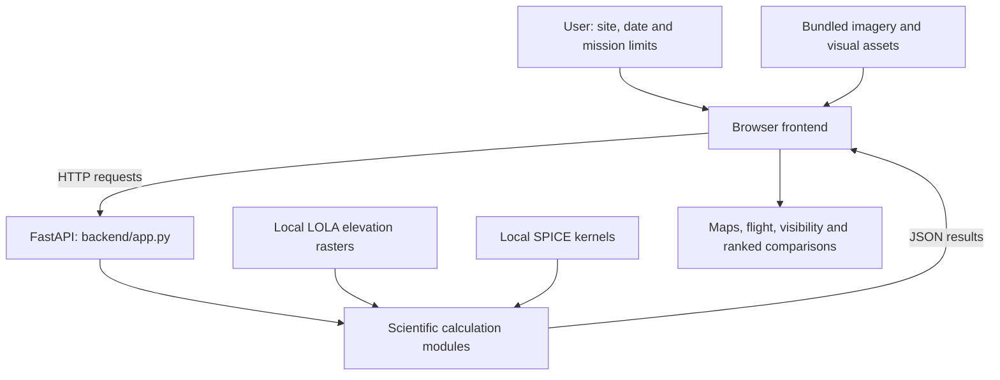
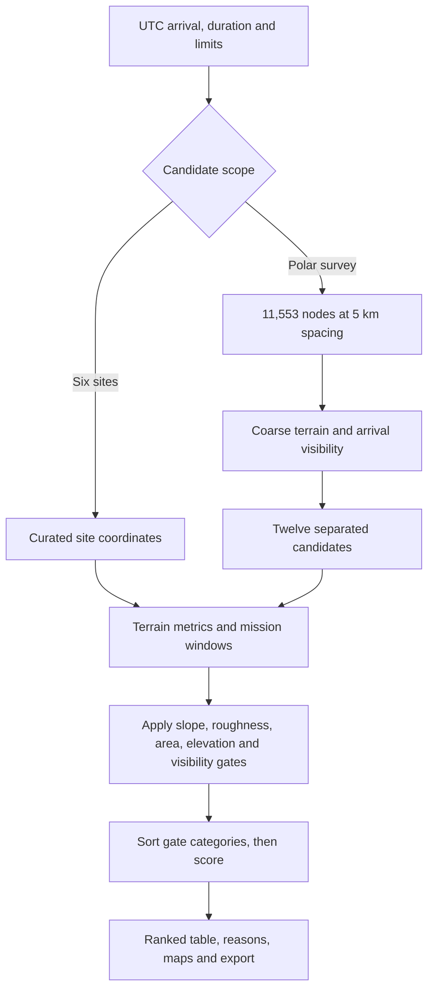

# Luna Scout — project architecture and workflow

This document maps the current implementation. The runtime has three main layers: a browser frontend, a Python scientific backend, and local datasets. This is an architecture guide, not a folder migration; existing paths and working links are preserved.

## 1. Folder architecture

```text
luna-scout/
    run.py                         Python application entry point
    start_windows.bat              Windows startup helper
    start_unix.sh                  Linux/macOS startup helper
    requirements.txt               Runtime Python dependencies
    requirements-dev.txt           Test/development dependencies
    package.json                   Optional managed-preview development command
    README.md                      General setup and project overview
    LICENSE                        Project license

    frontend/                      Browser interface and visual assets
        index.html                 Moon landing page and site selection
        mission.html               Mission planner and saved-scenario comparison
        navigator.html             Spacecraft flight and live visibility panel
        ranking.html               Terrain ranking, polar survey and image sources
        module.html                Standalone spacecraft inspection
        css/                       Styling and page layouts
        js/                        UI logic, rendering and client flight mechanics
        assets/                    Bundled images, textures and derived visual maps
        vendor/                    Bundled Three.js, OrbitControls and license

    backend/                       API and scientific calculations
        __init__.py                Python package marker
        app.py                     FastAPI routes, validation and static hosting
        sites.json                 Six named site/region reference coordinates
        terrain.py                 Raster loading, sampling and terrain horizons
        engine.py                  SPICE mission timelines and visibility windows
        celestial.py               Moon-relative Sun/Earth positions for the sky
        flight_status.py           Instant spacecraft illumination/Earth visibility
        surface.py                 Site-centred local LOLA terrain meshes
        safety.py                  Terrain metrics, screening gates and ranking
        polar_survey.py            Cap-wide coarse survey and refined shortlist

    data/                          Scientific inputs used by the backend
        terrain/                   LOLA elevation rasters and label files
        kernels/                   NAIF/JPL SPICE kernels
        manifest.json              Dataset inventory/checksum metadata

    docs/                          Methods, sources, validation and update guides
        PROJECT_ARCHITECTURE.md    This architecture and workflow guide
        DATA_SOURCES.md            Original data/source documentation
        METHOD.md                  Original scientific methodology
        VALIDATION.md              Original validation record
        NAVIGATOR_UPDATE.md        Navigator implementation notes
        FLIGHT_UPDATE.md           Spacecraft controls and sky model
        ILLUMINATION_TERRAIN_UPDATE.md
        SAFETY_RANKING_UPDATE.md    Current scoring and survey definitions
        SOUTH_POLE_IMAGE_SOURCES.json
        other research/validation reference files

    tests/                         Backend and scientific regression tests
        test_api.py
        test_science.py
        test_navigator.py
        test_celestial.py
        test_flight_status.py
        test_safety.py
        conftest.py
        js/
            flight-core.test.cjs
            landing-terrain.test.cjs

    scripts/                       Development and maintenance utilities
        dev.mjs                    Managed-preview adapter for Uvicorn
        build_manifest.py          Data-manifest generation utility

    original_frontend/             Preserved original frontend reference
    UPDATE_README.txt              Release/update installation instructions
    UPDATE_FILES.json              Release/update file inventory and checksums
```

`frontend/` is the active website. `original_frontend/` is a reference copy, not the served application. Earlier incremental update ZIPs contain changed source/assets and require the existing `data/` directory. The complete updated project ZIP includes `data/` and can be extracted into a fresh folder.

## 2. Runtime architecture



FastAPI serves the HTML/CSS/JavaScript and the `/api/` endpoints from the same local origin. Uvicorn runs the server. There is no separate Node production server, SQL database, login service or cloud calculation service in the current architecture. Calculations run locally using the supplied files; caches and saved comparisons are in memory. Saved frontend comparisons reset on a page reload unless exported.

## 3. Frontend responsibilities

| Page / feature | Main JavaScript | Responsibility |
|---|---|---|
| Moon home page | `moon-globe.js` | Moon rotation, real-coordinate markers, custom-point selection and navigator links |
| Shared sky | `moon-sky.js` | Sky clock, Sun/Earth position display, Earth orientation and direction inset |
| Mission planner | `planner.js` | API requests, horizon/timeline charts, engineering inputs, comparison sorting and exports |
| Planner background | `scene.js` | Still/live visual background controls; not scientific mission results |
| Flight navigator | `flight.js` | Scene assembly, controls, camera, beacon labels, landing transitions and local views |
| Flight mechanics | `flight-core.js` | Great-circle movement, boost, autopilot, beacon contact, descent and lift-off |
| Live flight status | `flight-telemetry.js` | Polls instantaneous visibility and displays snapshot time/position |
| Local landing appearance | `landing-terrain.js` | LOLA meshes, soil material and decorative small-scale surface detail |
| Spacecraft geometry | `lunar-module.js` | Shared detailed Apollo-style illustrative lander model |
| Safety ranking | `ranking.js` | Limits form, ordered results, survey maps, coarse grid priorities and JSON export |
| Graphics fallback | `cpu-moon.js`, `software-renderer.js` | Simplified rendering on systems without WebGL |
| Third-party graphics | `vendor/three.min.js`, `vendor/OrbitControls.js` | 3D rendering and orbit-camera controls |

Styling is split across `style.css`, `extension.css`, `globe.css`, `flight.css` and `ranking.css`. Older `app.js` and `navigator-data.js` remain as compatibility/reference code and are not loaded by the current home/spacecraft pages.

## 4. Backend responsibilities

| Module | Input | Output |
|---|---|---|
| `app.py` | HTTP query parameters | Validated requests, errors, JSON/CSV responses and static files |
| `terrain.py` | Latitude, longitude, observer height, terrain mode | Sampled elevations and a surrounding terrain skyline |
| `engine.py` | Site, UTC interval and engineering settings | Sun/Earth angles, visibility windows, solar power estimates and interval summaries |
| `celestial.py` | UTC interval and sampling cadence | Sun/Earth vectors in the lunar frame and Earth orientation matrices |
| `flight_status.py` | Current spacecraft coordinates, altitude and UTC | Instant illumination fraction and geometric direct-to-Earth status |
| `surface.py` | Site or custom coordinates | Local near/far LOLA elevation grids for rendering |
| `safety.py` | Terrain statistics, geometry, mission windows and limits | Gate results, score breakdowns and ordered candidates |
| `polar_survey.py` | UTC arrival, mission duration and limits | Regional grid, coarse visibility/priorities, twelve shortlisted candidates and refined ranking |
| `sites.json` | Curated reference data | Site names, coordinates, region/touchdown distinction and notes |

The backend owns the scientific visibility and ranking results. The frontend owns interaction and rendering. Client flight speeds, decorative rocks and photographic textures do not alter the scientific terrain measurements.

## 5. Scientific dataset folders

### `data/terrain/`

| File | Approximate source spacing | Current use |
|---|---:|---|
| `LDEM_80S_80MPP_ADJ.tiff` | 80 m | Default adjusted south-polar terrain, ranking and survey |
| `LDEM_60S_240M.JP2` | 240 m | Southern fallback including Shiv Shakti |
| `LDEM_16 (2).IMG` | 1.9 km | Global fallback including Apollo 11 |
| `LDEM_875S_20M.JP2` | 20 m | Optional fine terrain mode in the planner, for its covered polar region |
| `LDEM_85S_40M.JP2` | 40 m | Optional fine terrain mode fallback |
| `LDEM_80S_80M.JP2` | 80 m | Optional fine terrain mode fallback |
| Corresponding `.LBL` files | Metadata | Dataset labels and reference information |

Terrain ranking deliberately uses the adjusted stack. It does not silently mix the optional finer, unadjusted JP2 layers into the scoring datum. The global grid is too coarse for the current 2 km-diameter terrain safety screen, so Apollo 11 remains unassessed for that screen.

The loader applies 0.5 m/count scaling to the legacy integer JP2/global products. The adjusted TIFF is treated as metres. Coordinates are planetocentric latitude and east-positive longitude. The model uses a lunar reference radius of 1,737,400 m; reported elevation is not height above terrestrial sea level.

Dataset source documentation: `docs/DATA_SOURCES.md` and `docs/SAFETY_RANKING_UPDATE.md`. The existing raster files are supplied scientific inputs, not images downloaded every time the user runs the app.

### `data/kernels/`

| File | Role | Runtime status |
|---|---|---|
| `naif0012.tls.txt` | Leap-second/time conversion kernel | Loaded |
| `pck00011.tpc.txt` | Body constants and orientation definitions | Loaded |
| `de440s.bsp` | Planetary ephemeris | Active ephemeris |
| `moon_pa_de440_200625.bpc` | High-precision lunar orientation | Loaded |
| `moon_de440_250416.tf.txt` | Lunar reference-frame definitions | Loaded |
| `de442s.bsp` | Alternative supplied ephemeris/reference | Stored; not loaded by the active runtime engine |

The application uses SpiceyPy to access these NAIF kernels. A filename being present does not mean the active runtime uses it; `engine.py` defines the actual loaded stack.

## 6. Images versus measurement data

Scientific rasters belong in `data/terrain/`; display imagery belongs in `frontend/assets/`. They have different roles.

| Asset | Role |
|---|---|
| `south-pole-pia13523.jpg` | Verified NASA LROC south-pole mosaic for reference |
| `south-pole-oblique.png` | Verified LROC Shackleton-rim oblique observation |
| `south-pole-nadir.png` | Verified LROC geographic-pole observation |
| `moon-lroc-2k.jpg` | Global Moon appearance texture |
| `moon-height.png` | Derived global visual relief image |
| `earth-atmosphere.jpg` | Earth rendering texture |
| `apollo11-undisturbed-soil.png` | Illustrative landing-surface material; not a south-pole photograph |
| `south-pole.png` | Bundled polar-map reference image |

`docs/SOUTH_POLE_IMAGE_SOURCES.json` records the three verified south-pole image IDs, source URLs, dates, dimensions and file hashes. Image brightness is not used as a substitute for measured elevation, slope or roughness. Decorative craters and rocks are not registered hazard observations.

## 7. API map

| Endpoint | Used by | Main result |
|---|---|---|
| `GET /api/health` | Diagnostics | Backend status and supported date range |
| `GET /api/sites` | Home, planner and navigator | Curated site catalogue |
| `GET /api/timeline` | Mission planner | Terrain-aware mission timeline and default terrain assessment |
| `GET /api/celestial` | Shared sky | Moon-relative Sun/Earth vectors and Earth orientation |
| `GET /api/flight-status` | Spacecraft telemetry | Instant status at the ship's coordinates/altitude/time |
| `GET /api/surface` | Landed spacecraft view | Site-centred elevation grids |
| `GET /api/rank` | Ranking page | Six-site detailed ranking |
| `GET /api/south-pole` | Ranking page | Regional survey plus shortlisted/site ranking |
| `GET /api/export.csv` | API consumers | Timeline CSV for a named site |
| `GET /docs` | Developers | FastAPI interactive API documentation |

The frontend also creates CSV/JSON downloads in the browser. These are downloads to the user's computer, not records written into a server-side database.

## 8. Main user workflows

### Mission evaluation

1. The user selects a site or enters coordinates, arrival UTC and engineering settings.
2. `planner.js` calls `/api/timeline`.
3. `app.py` validates the request and invokes the calculation modules.
4. `terrain.py` samples LOLA and builds the terrain skyline.
5. `engine.py` computes SPICE Sun/Earth geometry, visibility windows and power estimates.
6. `safety.py` attaches regional terrain metrics and the default screening assessment.
7. The frontend draws charts, metrics and visibility states; pinned comparisons reorder by gate category and score.

### Spacecraft exploration

1. A home-page marker or custom Moon point opens `navigator.html`.
2. `flight-core.js` updates the craft's position and assisted flight state locally.
3. `moon-sky.js` requests celestial geometry; `flight-telemetry.js` requests current illumination/Earth status.
4. Beacon contact triggers assisted descent.
5. `/api/surface` supplies real local elevations; `landing-terrain.js` builds the landed view.
6. Lift-off returns to global flight. Visual inspection lighting does not change the scientific illumination status.

### Ranking and cap survey



All regional nodes receive a coarse priority index. Only the twelve shortlisted nodes plus the six existing sites receive the detailed ranking in survey mode. A 5 km lattice is a regional survey, not an exhaustive metre-scale hazard search. Elevation has an optional allowed corridor; higher elevation is not automatically safer.

## 9. Startup and development workflow

Normal application startup:

```bash
python -m venv .venv
```

Windows installation and launch:

```bat
.venv\Scripts\python.exe -m pip install -r requirements.txt
.venv\Scripts\python.exe run.py
```

Linux/macOS installation and launch:

```bash
.venv/bin/python -m pip install -r requirements.txt
.venv/bin/python run.py
```

Open `http://127.0.0.1:8000`. Core calculations use local files. Optional live NASA background content and Google Fonts need internet; the bundled scientific inputs and images do not need to be downloaded at runtime.

There is no frontend compilation step for normal use. `package.json` and `scripts/dev.mjs` support the development preview; they are not required to launch the Python app on the user's machine.

## 10. Verification and maintenance

Run Python tests from the project root:

```bash
python -m pip install -r requirements-dev.txt
python -m pytest -q tests
```

Run the optional Node geometry/flight tests:

```bash
node tests/js/flight-core.test.cjs
node tests/js/landing-terrain.test.cjs
```

The preceding implementation was verified with 38 Python tests and both Node suites. This architecture document itself does not change runtime behaviour.

Maintenance boundaries:

- Edit UI/layout in `frontend/`.
- Edit API/scientific behaviour in `backend/`, with corresponding tests.
- Keep original scientific files in `data/`; document any replacement, resolution, scaling or datum change.
- Keep source credits and methodology in `docs/`.
- Keep third-party graphics code and its license in `frontend/vendor/`.
- Keep generated exports outside the source tree unless intentionally committed as documented examples.
- Preserve `original_frontend/` as historical reference; do not serve it as the active site.

The current application is an educational/mission-screening prototype. Resolution limits, imagery dates and uncertainty are part of the architecture, because a visually detailed scene must not imply equally detailed scientific measurements.
